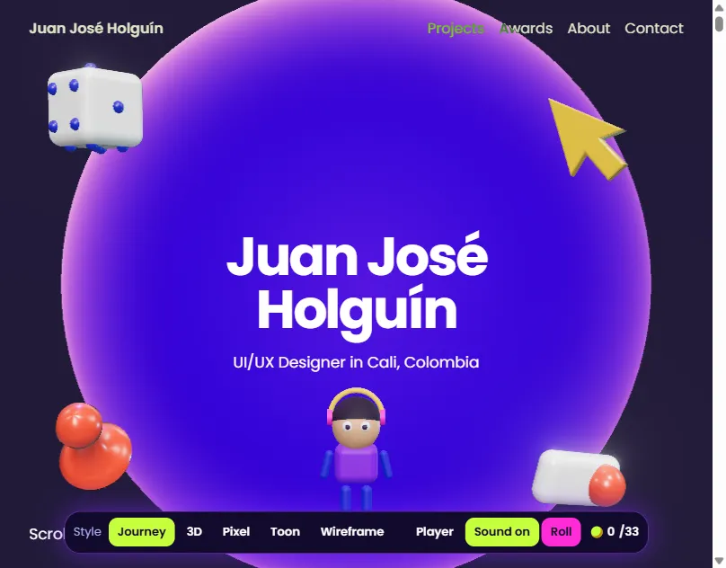

  

  
  
  
  

## Hi, I'm Juan José

I'm a designer who codes. I study Interactive Media Design at Universidad Icesi in Cali, Colombia, and I build digital experiences that are functional, visually engaging, and meaningful.

- **What I care about:** the balance between aesthetics, usability, and interaction.
- **What I do:** UI/UX, frontend development, motion, branding, and visual storytelling.
- **On campus:** student committee member for the Interactive Media Design program.
- **Off the clock:** music and sports.

## Awards

| Year | Award | Project |
|------|-------|---------|
| 2026 | **Best Visual Design**, Premio Equinoccio Icesi | [Carrera a la Locura](https://www.behance.net/gallery/256507675/Carrera-a-la-locura-Board-Game), a board game built with basic code and NFC |
| 2025 | **Best Audiovisual Design**, Premio Equinoccio Icesi | [Besos de Vino](https://www.behance.net/gallery/221578125/StopMotion-%28Animation%29-Poema-Besos-de-Vino), a stop-motion animated poem |

## Selected work

<table>
  <tr>
    <td width="33%" valign="top">
      
       <strong>3D Portfolio</strong>
       Scroll-driven site with a playable avatar, style switching, and live Behance projects.
       <a href="https://portfoliojuanjoseholguin.vercel.app">Live</a> · <a href="https://github.com/juanjoseholguin/Portfolio-Juan-Jos-Holgu-n">Code</a>
    </td>
    <td width="33%" valign="top">
      
       <strong>CollegePrep</strong>
       Web app that helps college students plan healthy, affordable meals.
       <a href="https://www.behance.net/gallery/252246803/CollegePrep-Smart-Budget-Meal-Planner">Case</a> · <a href="https://github.com/SALOMEDIAZ/CollegePrep">Code</a>
    </td>
    <td width="33%" valign="top">
      
       <strong>Espaiserman</strong>
       Interactive project focused on frontend development, creative coding, and visual storytelling.
       <a href="https://www.behance.net/gallery/234185511/Espaiserman-App">Case</a> · <a href="https://github.com/juanjoseholguin/ESPAISERMAN">Code</a>
    </td>
  </tr>
  <tr>
    <td valign="top">
      
       <strong>Carrera a la Locura</strong>
       Award-winning board game with a digital layer built on code and NFC.
       <a href="https://www.behance.net/gallery/256507675/Carrera-a-la-locura-Board-Game">Case</a>
    </td>
    <td valign="top">
      
       <strong>GameState</strong>
       Conceptual social network for sharing gaming clips, designed in Figma.
       <a href="https://www.behance.net/gallery/239441539/GameState-Gaming-Clip-Social-Network-(UXUI)">Case</a>
    </td>
    <td valign="top">
      
       <strong>Besos de Vino</strong>
       Award-winning stop-motion animated poem.
       <a href="https://www.behance.net/gallery/221578125/StopMotion-%28Animation%29-Poema-Besos-de-Vino">Case</a>
    </td>
  </tr>
</table>

Also: [DCA Project I](https://github.com/Migueg04/DCA-Proyect-I), a foundational project applying programming logic, structure, and collaborative development.

## Toolbox

**Design and motion**

**Development**

-3776AB?style=flat-square&logo=python&logoColor=white)

**Workflow**

## GitHub activity

  

## Let's talk

Open to projects and collaborations. Write to [juanjoseholguin128@gmail.com](mailto:juanjoseholguin128@gmail.com), or find me on [LinkedIn](https://www.linkedin.com/in/juan-jos%C3%A9-holgu%C3%ADn-b67062292/), [Behance](https://www.behance.net/juanjoholgun1), and [Instagram](https://instagram.com/juanjoseholguin_).
